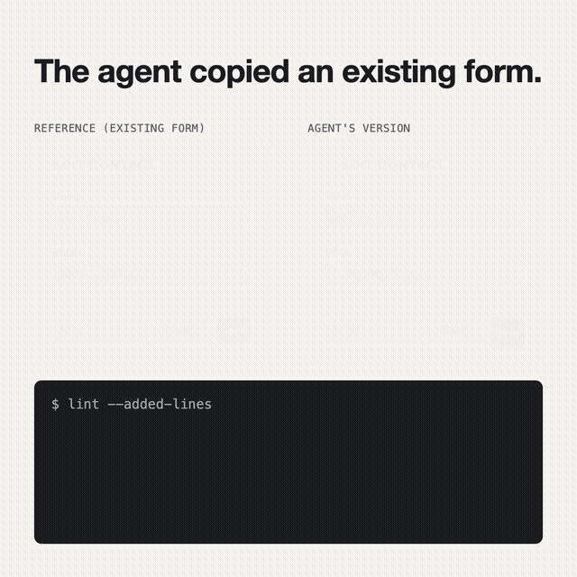
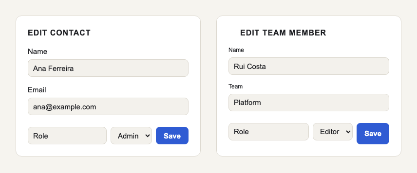

# style-vocab

[](https://github.com/PedroFMBranco/style-vocab/actions/workflows/test.yml)

Checks that new UI only uses style values a reference screen already uses: font sizes, weights, colours, spacing, radii, control heights and alignment, measured in the running app.

Coding agents copy an existing screen and change it. In a codebase that has drifted, they copy whichever drift they opened first, and lint can't tell: every class they wrote is legal. `style-vocab` opens the running app, measures the reference region and the new region, and lists every value the new one uses that the reference never does.



## Try it (2 minutes)

```bash
git clone https://github.com/PedroFMBranco/style-vocab && cd style-vocab
npm install && npx playwright install chromium
npm run demo         # the agent's version: 4 values off the reference, exit code 1
npm run demo:fixed   # the corrected version: MATCH, exit code 0
```

The demo is [demo/form.html](demo/form.html): an existing form on the left, and on the right a form an agent built by copying it.



```text
4 value(s) the reference never uses: fix them or justify each one
  ✗ fontSize 12 ×2
      at "Name" label
      at "Team" label
  ✗ controlHeight 44 ×1
      at "Save" button
  ✗ inset title 49 ×1
      at "Edit team member" h2
  ✗ rowMismatch 36px vs 44px ×1
      at "input / Save" div.row
```

Each of the agent's rules is fine on its own: a 12 px label, a 44 px button, padding on a heading. Next to the reference, they're drift.

## What it measures

`compare` collects the **vocabulary** of each region, which is every computed value rendered inside it:

| Bucket | What counts as off |
|---|---|
| font size, weight + case, colour | not used anywhere in the reference |
| gap, padding, radius, border colour | not used in the reference (±0.5 px) |
| control height | not used in the reference (±1.5 px) |
| icon size | not used in the reference (±1 px) |
| inset | where the title and the body start, from the region's left edge. Catches double padding, which the value buckets can't see |

Four defects fail whatever the reference does:

- **unreachable:** text or a control cut off by an `overflow: hidden` ancestor, or off screen with nothing to scroll
- **rawKey:** an untranslated key on screen (`settings.profile.title`)
- **overlap:** two text or control boxes drawn over each other, such as a field spilling out of its column
- **rowMismatch:** controls side by side in one flex row whose heights differ by more than 2.5 px

It compares computed values, not class names. Identical classes can render differently, for example when font sizes are inherited. Different classes can also render the same.

## Use it on your app

Install it in your project from GitHub (it isn't on npm yet), plus a browser for Playwright:

```bash
npm install -D github:PedroFMBranco/style-vocab
npx playwright install chromium
```

Then point it at your running app:

```bash
npx style-vocab compare --url http://localhost:5173 \
  --login login.json \
  --steps '[{"goto": "/settings"}, {"click": "text=Edit profile"}]' \
  --ref '[data-test=settings-page]' --new '[data-test=profile-dialog]'
```

- **`--ref`** can be the whole surface the new region lives in. The new region is left out of it automatically. Pass several `--ref`s to combine references.
- **`collect --selector <css> --save ref.json`** saves a reference vocabulary, so you can compare against a screen on another page with `--ref-json ref.json`.
- **`shot`** takes a screenshot only.
- **`sweep --plan plan.json --out dir [--against earlier-dir]`** captures many screens in one session and diffs their typography. Use it to show that a refactor changed nothing visible.
- **Steps:** `goto`, `click`, `clickText`, `clickAt`, `hover`, `fill`, `press`, `wait`, `resize`, `eval`. Any string can read an environment variable: `{"fill": ["#password", "${env:APP_PASSWORD}"]}`.
- **Output:** `page.png`, `ref-*.png`, `new.png` and `report.json` in `--out`, or a temp folder. Look at the screenshots too. The numbers don't catch everything.
- **Exit code:** 0 for a match, 1 for values off the reference or a defect, 2 for a usage error.

### Component libraries

Inputs, dropdowns and buttons from a component library set their own internal padding and radius. Tell `style-vocab` which elements are library components, so their insides aren't compared. Their font size and height still are, so overrides still show up. Put this in `style-vocab.config.json`, or pass it with `--config`:

```json
{
  "ownedSelector": ".MuiInputBase-root, .MuiButtonBase-root, .MuiSelect-root",
  "controlSelector": "button, input, select, textarea, [role=combobox]",
  "rowTolerance": 2.5
}
```

### Without the CLI

[src/probe.js](src/probe.js) is self-contained. Paste it into a devtools console, or into a browser MCP tool's `evaluate_script`, then call `window.__styleVocab.compare('#reference', '#new')`.

## The other two layers

Measuring is the last of three checks I give coding agents for UI work:

1. **Reference first.** The agent names the kind of surface and copies the structure of a reference from an approved list, not whatever it opens. [skill/SKILL.md](skill/SKILL.md) is a template for a Claude Code skill that does this. Fill in your own archetypes, reference files, drift list and rules.
2. **Lint the diff.** This check is static: it reads code and never sees the page. [examples/diff-lint.mjs](examples/diff-lint.mjs) is a minimal lint over added lines only. For Tailwind projects, [@shadcn/lint](https://github.com/shadcn-ui/lint) does this properly, with per-component contracts.
3. **Measure the render** with `style-vocab`, then look at the screenshots.

## Requirements

Node 18 or later, and Chromium through Playwright. Works on any web app you can open in a browser; it doesn't care which framework or CSS approach rendered the page.

## Limits

- It compares values, not intent. A value can exist in the reference and still be wrong in the new spot, so look at the screenshots.
- A reference that has drifted passes its drift on. Pick references you trust (the skill template keeps an approved list for this).
- Inside component-library controls it only checks font size and height, once you set `ownedSelector`.
- One page, one browser, one viewport per run. Run it again at other viewports if your layout changes with width.

## Develop

```bash
npm install && npx playwright install chromium
npm test   # runs the demo through the CLI: 3 planted defects found, fixed version matches
```

## License

MIT
